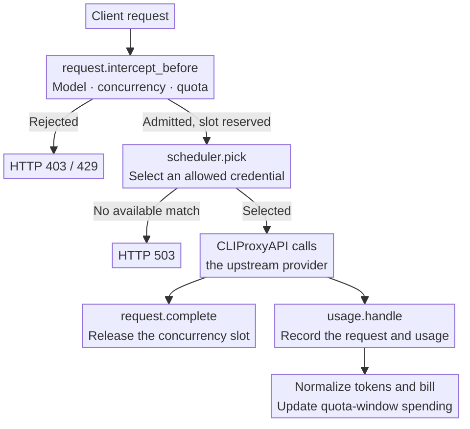
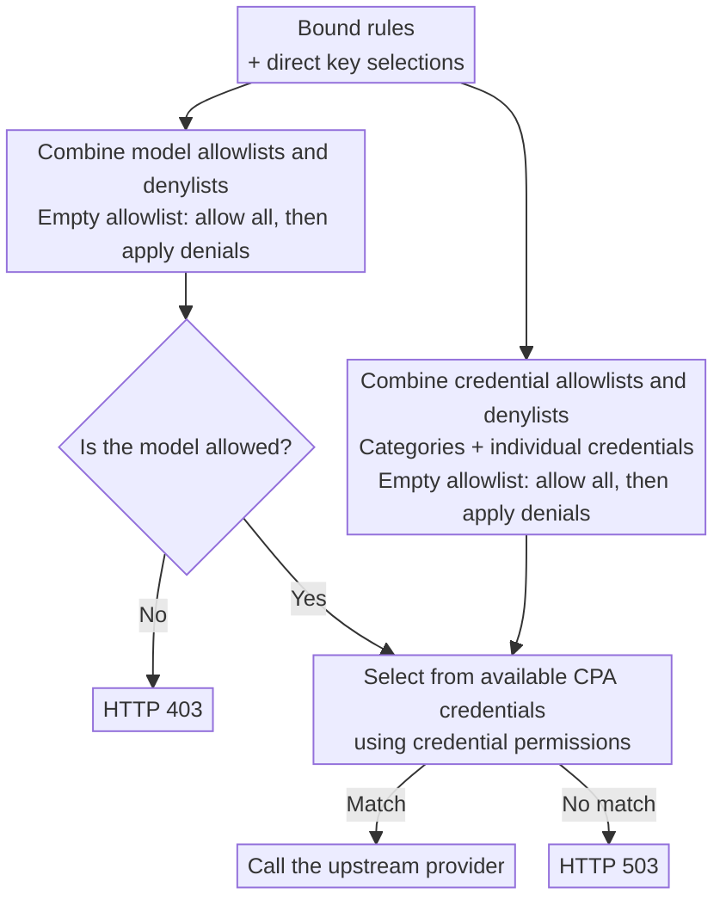

<div align="center">
  <h1>CPA CC Billing</h1>
  <p><strong>A <a href="https://github.com/router-for-me/CLIProxyAPI">CLIProxyAPI</a> plugin that splits one Claude subscription's quota between downstream API keys.</strong></p>
  <p>
    <a href="https://github.com/sketchain/cpa-cc-billing/releases/latest"></a>
    
    <a href="./LICENSE"></a>
  </p>
  <p><strong>English</strong> · <a href="./README.md">简体中文</a></p>
</div>

A fork of [cpa-key-billing](https://github.com/haowang02/cpa-plugin-key-billing). All of its billing, quota, concurrency and routing features remain; this fork adds the CC split.


## Features

- **CC split**: fixed keys get a fixed weekly amount (for example $100 a week), while remainder keys may only use what the account has left after reserving the fixed keys' unused amounts (weekly and 5-hour reservations).
- Estimates each Claude account's total in USD only from passively observed utilization headers, never polling upstream, and filters out usage of the account outside CPA.
- A balance endpoint for new-api Advanced Custom channels.
- Bulk import of custom prices from a JSON price list.

- Set spending, token, and request quotas for each API key, with independent or shared reset schedules.
- Price models and subscription plans in USD or CNY, and view usage statistics in either currency.
- Apply separate rates to requests that exceed a long-context input threshold.
- Limit concurrent requests per API key.
- Control access to models and upstream credentials with routing rules.
- Use model reference prices from [models.dev](https://models.dev/), with optional custom overrides.

## How it works

Before a request reaches an upstream provider, the plugin checks subscription quotas, concurrency, and routing. After execution, CLIProxyAPI supplies usage through `usage.handle`. The plugin uses that record to store the request event, calculate its cost, and update spending for the current quota window.



## CC split

### Concepts

- **Account**: one Claude OAuth credential in CPA (by `auth_index`), estimated on its own.
- **Pool**: a set of accounts that fixed and remainder keys share; its remaining capacity is the sum of its accounts'. The first account anchors the pool's weekly cycles and 5-hour window.
- **Fixed key**: bound, on the API Key page, to a subscription plan with a **7-day amount window**; that amount is its weekly quota. **Give each fixed key a plan of its own**: aligning cycles changes the plan itself, which affects every key bound to it.
- **Remainder key**: may only use what the pool has left after the fixed keys' reservations, optionally under its own weekly cap.

### Estimation

Anthropic reports `anthropic-ratelimit-unified-5h-utilization` and `7d-utilization` in whole percent only. Per account:

1. **1% segments**: every rise of the 5-hour utilization closes a segment whose cost is the plugin-priced cost of the account's requests during that point. Reports count at request start and costs at completion; out-of-order reports are absorbed because utilization never falls within a period, with the upstream 10-minute reorder horizon. Cost before a block's first rise is discarded.
2. **Blocks**: segments whose data points are at most 5 minutes apart; a 5-hour reset always breaks a block.
3. **Contamination filtering**: 8-point windows slide segment by segment; a window whose ratio (points per USD) exceeds the reference by 20% is suspicious, and a segment is excluded when at least 50% of the windows covering it are suspicious. The reference is the global weighted average, or the block's own iterative average while there is no history. Outside usage only raises ratios, so filtering only errs conservatively. Blocks narrower than one window are judged as a whole against the global reference.
4. **Global average**: clean block ratios weighted by `(clean gain)^p`; blocks of the last 14 days weigh 90%, older ones 10%. `T_5h = 100 / ratio`.
5. **k = weekly / 5-hour total**: paired 5-hour and 7-day gains between consecutive reports in which neither window reset, stored in hourly buckets with the segment retention. Like the totals, k is time-weighted: the last 14 days and older evidence each give `k = Σ5h / Σ7d`, valid once that group's 7-day gain reaches 10 points; two valid groups combine 90% / 10%, one valid group is used alone, otherwise the combined ratio counts if the total is enough, and without that there is no k. A manual value overrides it. `T_week = k × T_5h`.
6. **Cold start**: with fewer than 20 clean blocks, the tier's default weekly total applies (Pro $250, Max 5x $1250, Max 20x $2500). CPA's Claude credential files carry no tier, so choose it per account on the page (unset counts as Pro). In cold start `T_5h = default / k`; without a manual k and before k is estimated, 5-hour reservations stay off.

On synthetic data (whole-percent reports, concurrency, sporadic and sustained outside usage, 5-hour resets) the 5-hour total is within about +0.3% on clean data and about −3% (conservative) under sustained outside usage; k is within 1%.

### Admission

- Per account: `R_week = s × T_week × (1 − u_7d)` and `R_5h = s × T_5h × (1 − u_5h)`, with safety factor `s` (0.9).
- Per pool: `P_week = Σ fixed max(0, weekly − used this cycle)`; each fixed key reserves `max(0, min(weekly / k − used this 5h window, weekly remaining))` for 5 hours (the `1/k` share can be overridden per key).
- A remainder key is admitted only when `Σ R_week > P_week` and, when 5-hour reservations are on, `Σ R_5h > Σ 5-hour reservations`. Refusals use the plugin's usual `429 rate_limit_error`; the message names the weekly reservation, the 5-hour reservation or the key's own weekly cap, and `Retry-After` points at that window's reset.
- Fixed keys are only limited by their plan.
- Admission only reads an in-memory snapshot: keys outside every pool are admitted without touching the estimator; pooled keys combine the snapshot's totals with live utilization and live costs from usage callbacks, with no database query and no wait for a refresh. Refreshes run synchronously at startup, from usage callbacks (after the request, at most once a minute, skipped while one runs) and from the page's buttons; the plugin starts no background thread. Until the first snapshot loads, every request is admitted (logged once) and the balance endpoint returns 503.

### Fixed key cycles

The plugin switches the 7-day window of a fixed key's plan to a shared cycle anchored on the anchor account's 7-day `reset_at` (a rolling plan with other windows cannot be aligned; the page says so). After an early reset, detected as upstream `QuotaWindowPeriods` does, the current cycle keeps its usage and runs to its scheduled end; the next cycle ends at the account's new reset. Unused amounts expire and never pass to remainder keys. 5-hour reservations follow the anchor account's 5-hour window.

### Settings

Everything is set on the **CC split** page and stored in the database: segment retention (365 days, independent of request events), block gap (5 minutes), window width (8%), reference (global), suspicious threshold (20%), exclusion vote (50%), weight exponent p (2), recent period and share (14 days, 90%), weekly gain for k (10 points), cold start blocks (20), tier defaults ($250 / $1250 / $2500), safety factor (90%), each account's tier and manual k, and each key's type, pool, 5-hour share override or weekly cap.

### Auth files page

For Claude accounts in a CC pool, the auth files page (with **Quota estimate** on) and its detail drawer show the CC split's result instead of the estimate scaled by usage × 100 / used percent: the 5-hour and weekly totals, k with its source (auto or manual), R week / R 5h and the cold start state. They come from the latest estimate snapshot; opening the page does not refresh the estimates. Other accounts are unchanged.

### Balance endpoint for new-api

```text
GET /v0/resource/plugins/cpa-cc-billing/balance
Authorization: Bearer <downstream API key>
```

It returns `{"object":"credit_summary","total_available": <USD>}` for the week only: weekly amount minus usage for a fixed key, `Σ R_week − P_week` for a remainder key (capped by its own cap). Zero or less is reported as `1`, because new-api disables a channel whose balance is zero or less. Keys outside every pool get 404, unknown keys 401.

In new-api, create an **Advanced Custom** channel with the CPA address as Base URL and the downstream key as its key, and add a balance route whose `incoming_path` is `/v1/dashboard/billing/credit_grants` (the path new-api queries for balances) and whose `upstream_path` is `/v0/resource/plugins/cpa-cc-billing/balance`, with no converter and the default `Authorization: Bearer` authentication:

```json
{
  "advanced_routes": [
    { "incoming_path": "/v1/dashboard/billing/credit_grants", "upstream_path": "/v0/resource/plugins/cpa-cc-billing/balance", "converter": "none" }
  ]
}
```

### Price list import

Use **Import JSON** on the model pricing card, or `POST /v0/management/plugins/cpa-cc-billing/prices/import`. The file is an array or `{"models": [...]}` of entries with `name`, `aliases`, `input`, `output`, `cache_read` and `cache_write` in USD per million tokens. The name and every alias become custom prices; other fields, such as tier notes, are ignored.

## Migrating from cpa-key-billing

1. Stop CLIProxyAPI and back up `plugins/cpa-key-billing-state-v1.db` with its `-wal` and `-shm` files if present.
2. Copy it to `plugins/cpa-cc-billing-state-v1.db` (and the `-wal`/`-shm` files to the same new prefix).
3. Remove the old plugin library and its `plugins.configs.cpa-key-billing` entry (running both would refuse and bill twice), then install this plugin with a `plugins.configs.cpa-cc-billing` entry.
4. Start CLIProxyAPI. Keys, plans, routes, prices and request history are kept; the CC tables (`cc_meta`, `cc_segments`, `cc_streams`) are created automatically. The billing schema version is unchanged, so the original plugin can still open the file.
5. On the **CC split** page, choose account tiers, create a pool and assign keys. Segments are built from the retained request history right away.

## Requirements

- CLIProxyAPI **7.3.7 or later**. [Model list filtering](#model-lists) requires **8.0.37 or later**.
- A CLIProxyAPI build with plugin support. Builds labeled `no-plugin` cannot load this plugin.

## Installation

Run the installer from your CLIProxyAPI directory.

On macOS or Linux:

```sh
curl -LsSf https://raw.githubusercontent.com/sketchain/cpa-cc-billing/main/install.sh | sh
```

On Windows, stop CLIProxyAPI first, then run this in PowerShell:

```powershell
irm https://raw.githubusercontent.com/sketchain/cpa-cc-billing/main/install.ps1 | iex
```

The installer places the plugin in `plugins/` under the current directory. Restart CLIProxyAPI after installing or upgrading.

For manual installation, download the archive for your platform from [Releases](https://github.com/sketchain/cpa-cc-billing/releases/latest), then extract the library into CLIProxyAPI’s `plugins/` directory:

```text
plugins/cpa-cc-billing.so       # Linux
plugins/cpa-cc-billing.dylib    # macOS
plugins/cpa-cc-billing.dll      # Windows
```

## Configuration

Add the following to your CLIProxyAPI configuration:

```yaml
plugins:
  enabled: true
  dir: "plugins"
  configs:
    cpa-cc-billing:
      enabled: true
      priority: 100 # Plugin scheduling priority; higher values take precedence
      debug: false # Include routing and reference-price matching in debug logs
      codex_fast_mode_billing: false # Charge 2.5× for Codex priority requests
      allow_unpriced_models: false # Admit requests for unpriced models and record their usage at zero cost
      cny_per_usd: 7 # Exchange rate in CNY per USD, used to convert amounts between currencies
      mask_api_key_view_emails: false # Mask email addresses in API key account views
      allow_api_key_quota_reset: false # Allow API key users to reset accessible Codex and Claude auth file quotas using upstream resets
      request_event_retention_days: 365 # Retention in days for request events and their associated errors, a positive integer
      state_file: "plugins/cpa-cc-billing-state-v1.db"
      routing:
        strategy: "round-robin" # round-robin, weighted-round-robin, fill-first
        session-affinity: false # Reuse an available upstream credential for the same session
        session-affinity-ttl: "1h" # Idle timeout for session bindings
```

For requests with upstream credential restrictions, the plugin selects from the allowed credentials using the `routing` configuration above. Requests without upstream credential restrictions are handed to CPA for scheduling. The plugin's scheduling configuration is independent of CPA's global `routing` configuration.

CPA selects one scheduling plugin by priority rather than calling them in sequence. Set `priority: 100` to give this plugin precedence; omitting it uses CPA's default of `0`. The selected credential must satisfy the API key's routing rules regardless of which scheduler selected it. Requests return `503` if the credential violates those rules or its permissions cannot be verified, with the reason recorded in the plugin logs.

For initial selections or invalid session bindings, the plugin uses the highest available priority tier, then applies the selected strategy. With session affinity enabled, the same session reuses its bound credential while it remains available. Bindings expire after the idle period specified by `session-affinity-ttl`. Affinity requires a session identity supplied by CPA; requests without one follow the selected strategy.

> [!WARNING]
> Back up your data file before upgrading.
>
> - Databases of cpa-key-billing v1.0.0 or later can be used directly; see [Migrating from cpa-key-billing](#migrating-from-cpa-key-billing).
> - JSON and SQLite files from cpa-key-billing v0.8.4 or earlier cannot be migrated. Point `state_file` to a new file instead.

Restart CLIProxyAPI and open **CPA CC Billing** in the management panel. Review model pricing, create subscription plans, and bind the API keys whose quotas you want to enforce.

## Access

Administrators can open the plugin from the management panel or visit it directly:

```text
http(s)://<CLIProxyAPI address>/v0/resource/plugins/cpa-cc-billing/ui
```

API key holders can use their own key to view their subscription and usage:

```text
http(s)://<CLIProxyAPI address>/v0/resource/plugins/cpa-cc-billing/ui#account
```

The **Page display** card on the Settings page is stored in the database and starts from its defaults after an upgrade:

- Checked tabs are hidden from the navigation (Settings cannot be hidden); AI Providers is hidden by default. Hiding a tab only changes the page: its management API keeps working.
- **Allow API key users to view their own usage** is on by default. When off, the sign-in page no longer offers API key access and every resource route the self-service page uses returns 404; the `/balance` endpoint is unaffected.

## Billing and quotas

- Keys without a subscription plan still have their usage recorded, but have no subscription quota limit.
- A plan can contain multiple quota windows. Each window can limit spending, tokens, requests, or any combination of the three.
- Usage is tracked separately for each key, even when keys share a plan. Independent cycles start when the first request is admitted. Shared cycles use the configured schedule for every bound key.
- A manual quota reset keeps shared reset times unchanged. Independent cycles restart when the next request is admitted.
- Custom model prices take precedence over models.dev reference prices. Requests without any available price are rejected; with `allow_unpriced_models`, they are admitted and their usage is recorded at zero cost, while every other quota and routing limit still applies.
- Each custom price and subscription plan is in USD or CNY; built-in and reference prices are in USD. A request's cost stays in the currency of the price it used. A plan's spending quota counts in the plan's currency and converts other currencies at `cny_per_usd`. Changing the rate or a plan's currency never rewrites recorded amounts; quota usage converts at the current rate.
- The analysis, request event, auth file, and AI provider pages can show amounts in a chosen currency. The default, Auto, keeps each figure in the currency it was charged in and shows a mix of currencies in USD.
- Request events and their associated errors are retained for 365 days by default. Configure `request_event_retention_days` (1–106751 days) to change this; shortening it deletes history outside the new window. The request events page can clear all events or events older than a specified number of days; cleanup affects historical statistics and preserves subscription quota usage.

## Routing rules

Bind routing rules on the API key page, or set model and credential permissions directly on a key. Each selection cycles through three states: unselected, allowed (check mark), and denied (cross).

A credential-category selection covers all credentials in that category, including credentials added later. You can deny individual credentials within an allowed category.

The plugin combines all bound rules with the key’s direct selections. Model and credential permissions are evaluated separately: allowlists are combined, denylists are combined, and denials take precedence. An empty allowlist permits everything that is not explicitly denied.



### Model lists

On CLIProxyAPI 8.0.37 or later, the model list an API key receives contains only models its routing rules allow and an allowed credential serves, so clients no longer show models they cannot call. Older CLIProxyAPI versions still return the full model list.

## Rejection responses

| Condition | HTTP status | `type` | `code` |
| --- | --- | --- | --- |
| Concurrency limit reached | `429` | `rate_limit_error` | `rate_limit_exceeded` |
| Subscription quota exhausted | `429` | `rate_limit_error` | `rate_limit_exceeded` |
| Remainder key refused by a CC weekly or 5-hour reservation, or its own weekly cap | `429` | `rate_limit_error` | `rate_limit_exceeded` |
| Model access denied | `403` | `permission_error` | `insufficient_quota` |
| The credentials the routing rules allow do not serve the model, or none is available | `503` | `server_error` | `internal_server_error` |
| The selected credential violates the routing rules | `503` | `server_error` | `routing_credential_mismatch` |
| The selected credential's routing permissions cannot be verified | `503` | `server_error` | `routing_credential_unverified` |
| Model has no price and `allow_unpriced_models` is disabled | `503` | `cpa_cc_billing_error` | `model_price_error` |

## Acknowledgments

- [LINUX DO](https://linux.do/) community.
